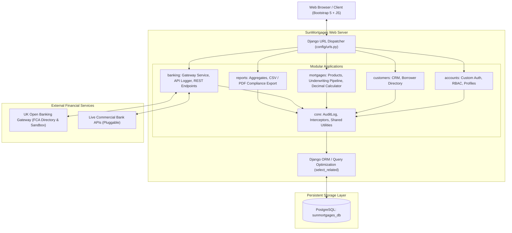
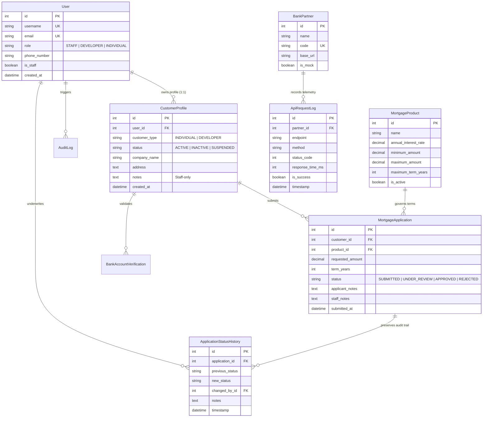

# SunMortgages — Enterprise Mortgage Management System

[](https://www.djangoproject.com/)
[](https://www.postgresql.org/)
[](https://getbootstrap.com/)
[](#7-automated-testing)

**SunMortgages** is a full-stack, secure, role-based financial web application designed to manage the end-to-end mortgage lifecycle. Built on Django, PostgreSQL, and Bootstrap 5, it supports Individual Borrowers, Commercial Property Developers, and Financial Staff/Underwriters, coupled with a modular banking gateway framework.

---

## 1. System Architecture

### 1.1 Application Architecture


### 1.2 Relational Database Schema


---

## 2. Key Features by Role

### 2.1 Authorized Staff / Underwriters
- **Underwriting Dashboard**: Live graphical KPI charts (Chart.js), status breakdown, active portfolio metrics.
- **Customer CRM**: Searchable directory of borrowers; view/edit profiles, add confidential staff notes.
- **Scheme Manager**: Add, edit, or toggle public mortgage schemes with minimum and maximum bounds validation.
- **Application Pipeline**: Full decision management (`SUBMITTED` &rarr; `UNDER_REVIEW` &rarr; `APPROVED` / `REJECTED`) with transactional audit history.
- **Banking Gateway Portal**: Test bank account validation, monitor API telemetry logs, and inspect market interest rates.
- **Compliance Reporting**: Filter applications and export audit-ready CSV spreadsheets and printable PDF reports.

### 2.2 Property Developers
- **Corporate Dashboard**: Multi-scheme tracking, commercial portfolio borrowing summaries.
- **Business Profile**: Maintain company registration, registered offices, and business details.
- **Commercial Financing**: Apply for large-scale development schemes (e.g. £200,000 to £5,000,000).

### 2.3 Individual Customers
- **Personal Dashboard**: View application status badges, personal profile, and direct loan submission shortcuts.
- **Decimal Amortisation Calculator**: High-precision loan repayment estimator computing exact monthly commitments, total repayment, and cumulative interest.

---

## 3. Technology Stack

| Component | Technology | Version | Purpose |
| :--- | :--- | :--- | :--- |
| **Backend Framework** | Django | 6.0.10 | Core MVC architecture, ORM, authentication |
| **Database** | PostgreSQL | 15+ | Relational data persistence with strict foreign keys |
| **Database Driver** | Psycopg 3 | 3.3.9 | Modern PostgreSQL driver for Python |
| **API Framework** | Django REST Framework | 3.18.3 | Programmatic REST endpoints for bank services |
| **HTTP Client** | Requests | 2.34.2 | External gateway network communication |
| **Frontend UI** | Bootstrap 5.3 + FontAwesome | 5.3.3 | Responsive financial services design |
| **Data Visuals** | Chart.js | 4.x | Real-time pipeline doughnut and bar charts |
| **WSGI Server** | Gunicorn | 27.0.1 | Production UNIX application server |

---

## 4. Security Implementation

1. **Role-Based Access Control (RBAC)**: All views are protected with `@login_required` and custom decorators like `@user_passes_test(staff_required)` ensuring customer accounts cannot access staff directories or reporting endpoints.
2. **Confidentiality Safeguards**: Internal underwriter notes are strictly excluded from all customer-facing forms and templates.
3. **Transactional Integrity**: Status changes and financial allocations execute within `transaction.atomic()` blocks, writing concurrent entries to `ApplicationStatusHistory` and `AuditLog`.
4. **Relational Deletion Protection**: Mortgage applications utilize `on_delete=models.PROTECT` on Customer Profile and Mortgage Product relationships, preventing accidental deletion of active financial commitments.
5. **CSRF & Injection Defenses**: All forms enforce Django's cryptographic CSRF tokens; database operations use parameterized queries through the Django ORM to eliminate SQL injection vulnerabilities.
6. **Data Masking**: Account numbers stored in API request telemetry logs are automatically masked (e.g., `****0192`) to uphold banking privacy standards.

---

## 5. Local Setup & Installation

### Prerequisites
- macOS (Apple Silicon M1/M2/M3/M4/M5 supported)
- Python 3.12+ (or Python 3.14 alpha with included compatibility patches)
- PostgreSQL running locally on port 5432

### Step-by-Step Instructions

1. **Navigate to the Project Directory**:
   ```bash
   cd ~/Desktop/SunMortgages
   ```

2. **Activate the Virtual Environment**:
   ```bash
   source venv/bin/activate
   ```

3. **Install Requirements**:
   ```bash
   pip install -r requirements.txt
   ```

4. **Configure Environment Variables (`.env`)**:
   Ensure your `.env` file contains your PostgreSQL database credentials:
   ```env
   SECRET_KEY=your-secure-django-secret-key
   DEBUG=True

   DB_NAME=sunmortgages_db
   DB_USER=sunmortgages_user
   DB_PASSWORD=YourDatabasePassword
   DB_HOST=127.0.0.1
   DB_PORT=5432

   PSYCOPG_IMPL=python
   ```

5. **Run Database Migrations**:
   ```bash
   python manage.py migrate
   ```

6. **Start the Development Server**:
   ```bash
   python manage.py runserver
   ```
   Open your browser at **`http://127.0.0.1:8000/`**.

---

## 6. Pre-Configured Test Accounts

The system includes pre-seeded demonstration accounts:

| Role | Username | Password | Access Highlights |
| :--- | :--- | :--- | :--- |
| **Staff Officer** | `admin` | `Admin1234!` | Full Underwriting Suite, CRM, Bank Gateway, Reports, Admin |
| **Property Developer** | `apex_developments` | `Developer1234!` | Developer Schemes, Business CRM, Commercial Portfolio |
| **Individual Borrower** | `sarah_jenkins` | `Customer1234!` | Personal Profile, Loan Applications, Amortisation Tool |

---

## 7. Automated Testing

The application includes an automated test suite verifying registration, RBAC permissions, CRM bounds, application state machines, amortisation mathematics, banking services, and reporting streams:

```bash
python manage.py test
```

### Verification Output:
```
Found 24 test(s).
Creating test database for alias 'default'...
System check identified no issues (0 silenced).
........................
----------------------------------------------------------------------
Ran 24 tests in 12.915s

OK
Destroying test database for alias 'default'...
```

---

## 8. Production Deployment Guide

### 8.1 Production Configuration
In `config/settings.py` for live hosting:
- Set `DEBUG = False`
- Set `ALLOWED_HOSTS = ['yourdomain.com', 'www.yourdomain.com']`
- Enable HTTPS headers:
  ```python
  SECURE_SSL_REDIRECT = True
  SESSION_COOKIE_SECURE = True
  CSRF_COOKIE_SECURE = True
  SECURE_HSTS_SECONDS = 31536000
  ```

### 8.2 Gunicorn Application Server
Run the production WSGI server:
```bash
gunicorn config.wsgi:application --workers 3 --bind 127.0.0.1:8000
```

### 8.3 Nginx Reverse Proxy Configuration
```nginx
server {
    listen 80;
    server_name sunmortgages.example.com;
    return 301 https://$host$request_uri;
}

server {
    listen 443 ssl;
    server_name sunmortgages.example.com;

    ssl_certificate /etc/letsencrypt/live/sunmortgages.example.com/fullchain.pem;
    ssl_certificate_key /etc/letsencrypt/live/sunmortgages.example.com/privkey.pem;

    location /static/ {
        alias /var/www/sunmortgages/static/;
    }

    location / {
        proxy_pass http://127.0.0.1:8000;
        proxy_set_header Host $host;
        proxy_set_header X-Real-IP $remote_addr;
        proxy_set_header X-Forwarded-For $proxy_add_x_forwarded_for;
        proxy_set_header X-Forwarded-Proto $scheme;
    }
}
```

---

## 9. Academic Project Information
- **Course**: Advanced Software Engineering Capstone
- **Project Title**: SunMortgages Multi-Tier Mortgage Management Platform
- **Lead Developer**: Om Prakash Shah
- **Supervision**: Faculty of Computer Science & Software Engineering
